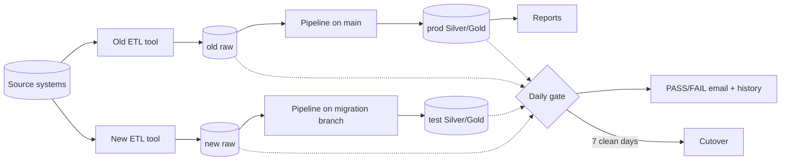

# Enterprise ETL Tool Migration Kit

Enterprise approach to migrating off an ETL tool: full table inventory, parallel pipelines on a branch, automated daily validation, and a safe cutover with zero report downtime.

Built from a real migration of 251 ERP tables between two ingestion tools. Tool-neutral: works for Fivetran, Airbyte, Stitch, an in-house loader, anything that lands tables in a warehouse.

## The idea

Nobody signs off by eyeballing data. Old and new pipelines run side by side, a gate compares them every day, and a wave switches only after **7 clean days in a row**.



## The 6 stages

| # | Stage | What it does | Folder |
|---|---|---|---|
| 1 | Inventory | Every table the old tool loads, who reads it, who owns it, which wave | [1_inventory](1_inventory) |
| 2 | Ingest | New tool loads the same tables from the same sources | [2_ingest](2_ingest) |
| 3 | Parallel pipelines | Same models run twice: main reads old tool into prod, migration branch reads new tool into a test schema | [3_pipelines](3_pipelines) |
| 4 | Gate | Compares every table at RAW, Silver and Gold, row by row, stores results, emails PASS/FAIL | [4_gate](4_gate) |
| 5 | Cutover | Only runs when the gate is green. Writes revoke + exact restore scripts | [5_cutover](5_cutover) |
| 6 | Turn off | Backup window, pause, then delete the old tool | [docs/playbook.md](docs/playbook.md) |

## Run it

```bash
pip install -r requirements.txt
python run_demo.py
```

It builds a fake company with planted problems, and you watch the gate catch them:

```
RAW     legacy_raw.customers     FAIL    1 rows only in new; 2 rows with different values
RAW     legacy_raw.orders        FAIL    3 rows only in old
GOLD    prod.gold_sales_by_day   FAIL    3 rows with different values
4 of 9 PASS. Clean days in a row: 0 of 7.
...
9 of 9 PASS. Clean days in a row: 1 of 7.
BLOCKED: not enough clean days. Nothing written.
```

## Use it for real

- Point `common.connect()` at your warehouse (Snowflake, BigQuery, Databricks). The SQL is standard.
- Fill `1_inventory/owners.csv` and `4_gate/table_pairs.csv` with your tables.
- Set the bookkeeping column names in `4_gate/gate.py` (e.g. `_fivetran_deleted`, your new tool's load timestamp).
- Schedule `python 4_gate/gate.py --email` after both loads land. [.github/workflows/daily-gate.yml](.github/workflows/daily-gate.yml) shows it on a daily cron.

Full playbook: [docs/playbook.md](docs/playbook.md)
